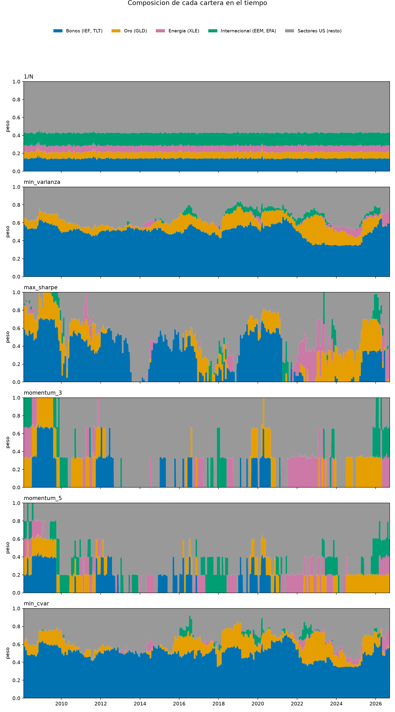
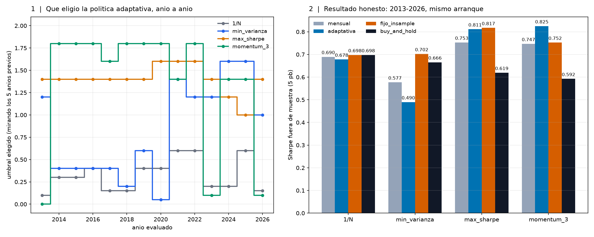
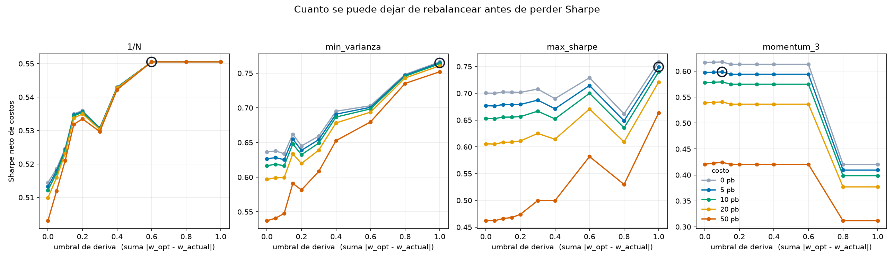
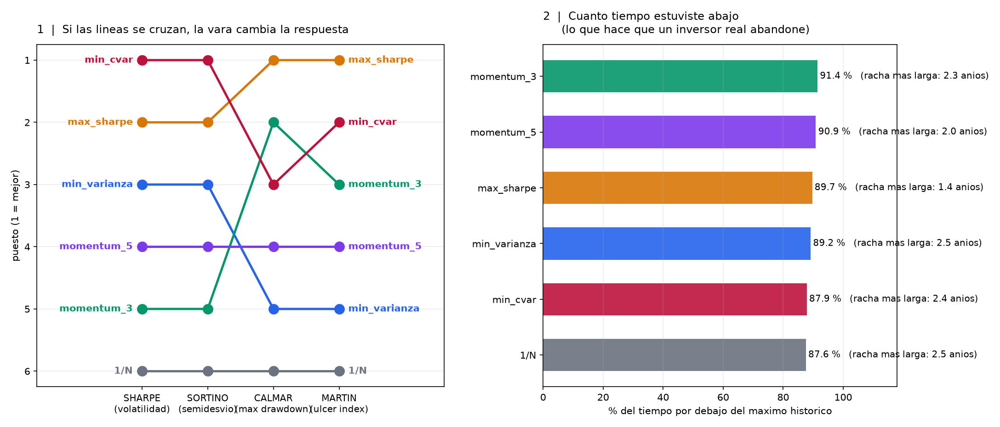
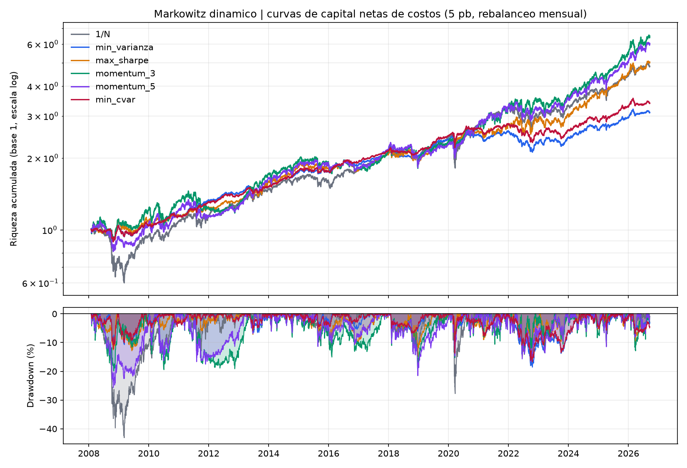

# Dynamic Markowitz — when is rebalancing worth it?

**A walk-forward study of rebalancing thresholds, risk measures, and what mean-variance optimisation is actually doing.**

Mean-variance optimisation estimates expected returns (μ) and the covariance matrix (Σ) from past data. Those estimates start going stale the moment they are computed. This project asks a falsifiable question:

> **Is there a threshold of new information below which rebalancing destroys more value than it creates?**

14 ETFs · 2008–2026 · walk-forward · 5 bps transaction costs · 19 tests · no look-ahead.

---

## Four findings

### 1. Max-Sharpe is a momentum strategy in disguise

μ estimated as the mean of the last 252 trading days **is**, almost literally, a 12-month momentum signal (Jegadeesh & Titman, 1993). The portfolio weights make this unmistakable: the max-Sharpe strategy held **0 % energy for thirteen consecutive years**, then 15.5 % in 2021, 34 % in 2022, and 0 % again by 2023 — in late, out late.

A naive benchmark — rank by μ, hold the top 3, equal-weighted, no covariance matrix at all — **earns more** than the optimiser:

| | annual return | volatility | max drawdown | turnover | final wealth |
|---|---|---|---|---|---|
| `momentum_3` (no Σ) | **10.57 %** | 15.49 % | −21.24 % | 6.10 | **6.49** |
| `max_sharpe` (μ + Σ) | 9.09 % | 10.76 % | −15.45 % | 5.13 | 5.05 |

Since both use the same signal, the difference isolates what Σ contributes:

```
volatility      -30.5 %     improvement
max drawdown    -27.3 %     improvement
turnover        -15.9 %     improvement
annual return   -14.0 %     cost  (-1.48 pp)
                ---------------------------
Sharpe          +13.2 %     net
```

**Markowitz does not find the opportunity. μ finds it. Markowitz makes it tolerable.**



### 2. The drift trigger works — but its sign flips with the input

The rebalancing rule trades only when the portfolio has drifted far enough from the optimum:

```
distance = sum of |w_optimal - w_current|      (L1 norm)
trade  if  distance > threshold
```

That distance *is* the turnover the trade would cost, so the rule reads: *trade only if the move is big enough to be worth it*. It is the no-transaction region of Constantinides (1986) and Davis & Norman (1990) — structurally an (s, S) inventory policy.

Thresholds were selected **walk-forward**: each year, pick the threshold that performed best over the previous five years only, then apply it blind. Evaluation on 2013–2026, all policies starting from an identical portfolio on 1 Jan 2013.

| strategy | driven by | Sharpe vs monthly rebalancing | turnover |
|---|---|---|---|
| `momentum_3` | μ only | **+10.5 %** | −63 % |
| `max_sharpe` | μ + Σ | **+7.8 %** | −71 % |
| `1/N` | neither | −1.7 % | −84 % |
| `min_varianza` | Σ only | **−15.1 %** | −72 % |

The sign reverses. μ is noise-dominated, so most of its monthly rebalances chase sampling error and filtering them helps. Σ is informative and slow-moving, so its rebalances are few but meaningful — blocking them lets the portfolio drift toward the high-volatility assets and **raises** realised volatility from 6.87 % to 7.45 %, destroying the only property that strategy buys.



### 3. The threshold is a noise filter, not a cost control

The original hypothesis was about costs. Decomposing the return difference says otherwise:

```
max_sharpe
  cost saved     = (5.353 - 1.559) x 0.0005 = 0.19 pp/year
  total gain                                 = 1.29 pp/year
  -> cost savings explain 15 %. The rest is a different portfolio.

momentum_3
  cost saved     = (6.050 - 2.220) x 0.0005 = 0.19 pp/year
  total gain                                 = 1.89 pp/year
  -> cost savings explain 10 %.
```

85–90 % of the effect comes from **holding a different portfolio**, not from saving commissions. The threshold acts as a significance level: *ignore the change unless it is too large to be sampling noise*. It is a hypothesis test implemented as a trading rule.



### 4. Variance and drawdown rank strategies differently

Variance is a symmetric average of squared deviations with no memory of order. Drawdown is entirely path-dependent. Measuring the same six strategies with four different yardsticks:

| rank (1 = best) | Sharpe | Sortino | Calmar | Martin |
|---|---|---|---|---|
| `min_cvar` | 1 | 1 | 3 | 2 |
| `max_sharpe` | 2 | 2 | **1** | **1** |
| `min_varianza` | 3 | 3 | **5** | **5** |
| `momentum_5` | 4 | 4 | 4 | 4 |
| `momentum_3` | 5 | 5 | **2** | **3** |
| `1/N` | 6 | 6 | 6 | 6 |

**Four of six strategies change rank**, and every crossing happens at the same place: the boundary between volatility-based and path-based measures.

The sharpest single number:

```
                volatility    max drawdown
max_sharpe        10.76 %        -15.45 %
min_cvar           7.06 %        -16.66 %      -34 % vol,  +8 % deeper
min_varianza       6.90 %        -18.57 %      -36 % vol, +20 % deeper
```

Both risk-minimising portfolios fall **deeper** than the one that does not minimise risk at all. If variance captured downside risk, this could not happen.

Measured by Sharpe, max-Sharpe beats minimum-variance by 8 %. Measured by Calmar, by 74 %. The choice of yardstick multiplies the gap ninefold.



---

## Extension: minimum-CVaR optimisation

Drawdown cannot be placed inside the objective — it is neither convex nor a closed-form function of w. CVaR can, and this is a theorem. Rockafellar & Uryasev (2000) showed that

```
CVaR_beta(w) = min over alpha of
               alpha + (1/((1-beta) T)) * sum_t max(0, loss_t - alpha)
```

is jointly convex in (w, alpha), and that introducing one auxiliary variable per scenario turns it into a **linear program** — here, 267 variables and 252 inequality constraints, solved exactly in milliseconds (`src/optimizer_cvar.py`).

Result on this universe: **minimising CVaR produces almost the same average portfolio as minimising variance.**

```
L1 distance between average portfolios
  min_varianza  vs  min_cvar        7.4 pp
  min_varianza  vs  max_sharpe     56.5 pp
```

All three of their worst drawdown episodes share **identical peak and trough dates**. What does differ is the cost of estimating the objective: at β = 0.95 with a 252-day window, CVaR is determined by **12.6 tail days**, so the optimum jumps month to month and turnover rises 78 % (1.37 → 2.44 per year).

Net effect: +0.52 pp annual return, 10 % shallower drawdown, best Ulcer Index of all six — and a Sharpe difference that is not statistically significant.

**For a universe of 14 diversified ETFs, the tail carries little information the covariance matrix does not already hold.** The measure that targets drawdown directly and is also an LP is CDaR (Chekhlov, Uryasev & Zabarankin, 2005); it is proposed, not implemented.

---

## Full results

2008-02-01 to 2026-09-18, monthly rebalancing, 5 bps per unit turnover, rf = 2 %.

| | return | vol | max DD | Ulcer | underwater | Sharpe | Sortino | Calmar | Martin | turnover |
|---|---|---|---|---|---|---|---|---|---|---|
| `1/N` | 8.85 % | 14.75 % | −43.11 % | 8.35 | 87.6 % | 0.513 | 0.719 | 0.205 | 0.821 | 0.34 |
| `min_varianza` | 6.27 % | 6.90 % | −18.57 % | 4.38 | 89.2 % | 0.627 | 0.879 | 0.338 | 0.975 | 1.37 |
| `max_sharpe` | 9.09 % | 10.76 % | −15.45 % | 4.19 | 89.7 % | 0.677 | 0.945 | **0.588** | **1.694** | 5.13 |
| `momentum_3` | **10.57 %** | 15.49 % | −21.24 % | 7.20 | 91.4 % | 0.598 | 0.830 | 0.498 | 1.192 | 6.10 |
| `momentum_5` | 10.15 % | 14.28 % | −25.68 % | 7.44 | 90.9 % | 0.609 | 0.845 | 0.395 | 1.096 | 4.90 |
| `min_cvar` | 6.79 % | 7.06 % | −16.66 % | **3.91** | 87.9 % | **0.683** | **0.960** | 0.407 | 1.226 | 2.44 |

One number worth noticing: every strategy spends **88–91 % of its life below its own all-time high**. A portfolio is at a new peak roughly one day in ten.



---

## Method

**Data.** 14 ETFs (9 US sector SPDRs, 2 international equity, 2 Treasury funds, gold), daily adjusted closes from Yahoo Finance, 2007-01-03 to 2026-09-18. 4,958 return observations; 4,687 after the estimation burn-in.

**Engine** (`src/backtest.py`). Walk-forward with no look-ahead. On the last trading day of each month the estimator sees only `returns.loc[:t].iloc[-252:]`; weights then drift with realised returns until the next decision date. Transaction costs are charged as `c × |w_new − w_old|₁` on the first day after a trade. The estimator, optimiser and trigger are injected as arguments, so one engine serves every strategy — including minimum-CVaR, which needs the raw scenario matrix instead of (μ, Σ).

**Constraints.** Long-only, fully invested, 35 % cap per asset. The no-short constraint is itself a form of shrinkage on Σ (Jagannathan & Ma, 2003), which partly explains why the optimised portfolios survive out of sample better than the unconstrained literature would predict.

**Tests** (19, `pytest -q`). Three matter most:

1. **Reproduction** — with rebalancing disabled and zero costs, the engine reproduces a closed-form buy-and-hold to 1e-13. Validates the drift mechanics and the loop boundaries.
2. **Truncation** — truncating the data in 2021 leaves every pre-2021 return bit-identical. This is what rules out look-ahead bias.
3. **Cost accounting** — running at 0 bps and 50 bps, the difference equals `c × turnover` on exactly the right days and nowhere else.

---

## Limitations

Stated here rather than buried, because a backtest that reports only its best number is not evidence.

- **One sample path.** 18.6 years, one market, one realisation. Every Sharpe difference reported above has a Memmel-corrected t-statistic between 0.4 and 1.3. **None is statistically significant.** What survives: turnover reductions (deterministic), volatility differences (estimated from 4,687 observations), and the direction of the sign reversal in finding 2.
- **Overfitting, measured.** Choosing the drift threshold in-sample overstated the gain for `min_varianza` by **43 %** relative to walk-forward selection (0.702 vs 0.490 Sharpe). The in-sample benchmark is itself a partial cheat, since it selects over a window larger than the evaluation period — so 43 % is a conservative figure.
- **Universe selection.** The 14 tickers were chosen in 2026 among ETFs that exist and survived. The strategy results are out-of-sample; the universe is not.
- **Flat risk-free rate.** rf = 2 % throughout, while actual short rates went 5 % → 0 % → 5 %. This shifts the level of every Sharpe but not the ranking.
- **Cost model.** 5 bps linear in turnover. No bid-ask spread modelling, no market impact, no whole-share lots, **no taxes** — which in a real account would dominate everything measured here.
- **Momentum specification.** The signal uses the full 252-day window. The canonical specification skips the most recent month (t−12 to t−2) to avoid short-term reversal.
- **CVaR sample size.** At β = 0.95 the objective is determined by ~13 observations. A robustness check at β = 0.90 (25 tail days) is not yet run.

---

## Reproducing

```bash
conda env create -f environment.yml
conda activate markowitz
pytest -q                           # 19 tests

python src/data_loader.py           # downloads prices (optional: data/prices.parquet is committed)
python src/correr_backtest.py       # six strategies, metrics, weights
python src/barrido_deriva.py        # drift-threshold sweep, 5 cost levels
python src/validacion_rodante.py    # walk-forward threshold selection
python src/analisis_drawdown.py     # multi-measure risk table
python src/graficar_*.py            # figures
```

Heavy computation lives in scripts that write to `results/`; notebooks only read and plot. That separation was forced by a kernel-crash problem early on and kept because it turned out to be the right architecture.

---

## Repository layout

```
src/
  data_loader.py          download and store prices
  estimators.py           sample (mu, Sigma)
  optimizer.py            min-variance, max-Sharpe (SLSQP)
  optimizer_cvar.py       min-CVaR (linear program, Rockafellar-Uryasev)
  backtest.py             the walk-forward engine
  metrics.py              Sharpe, annualised return/vol, max drawdown
  metricas_riesgo.py      Ulcer, Sortino, Calmar, Martin, CVaR, episodes
  correr_backtest.py      runs all six strategies
  barrido_deriva.py       threshold grid x cost grid
  validacion_rodante.py   walk-forward threshold selection
  analisis_drawdown.py    multi-measure risk comparison
  correlacion_regimen.py  rolling stock-bond correlation
  diagnostico_2022.py     estimated vs realised volatility, 2022
tests/                    19 tests
data/prices.parquet       the exact dataset behind every number here
results/                  generated tables and figures
figuras/                  figures referenced in this README
```

---

## References

Chekhlov, Uryasev & Zabarankin (2005), *Drawdown measure in portfolio optimization* · Constantinides (1986), *Capital market equilibrium with transaction costs* · Daniel & Moskowitz (2016), *Momentum crashes* · Davis & Norman (1990), *Portfolio selection with transaction costs* · DeMiguel, Garlappi & Uppal (2009), *Optimal versus naive diversification* · Jagannathan & Ma (2003), *Risk reduction in large portfolios* · Jegadeesh & Titman (1993), *Returns to buying winners and selling losers* · Ledoit & Wolf (2004), *A well-conditioned estimator for large-dimensional covariance matrices* · Markowitz (1952), *Portfolio selection* · Martin & McCann (1989), *The investor's guide to fidelity funds* (Ulcer Index) · Memmel (2003), *Performance hypothesis testing with the Sharpe ratio* · Michaud (1989), *The Markowitz optimization enigma* · Rockafellar & Uryasev (2000), *Optimization of conditional value-at-risk*

---

*Personal project. Built to answer a question, not to sell a strategy.*